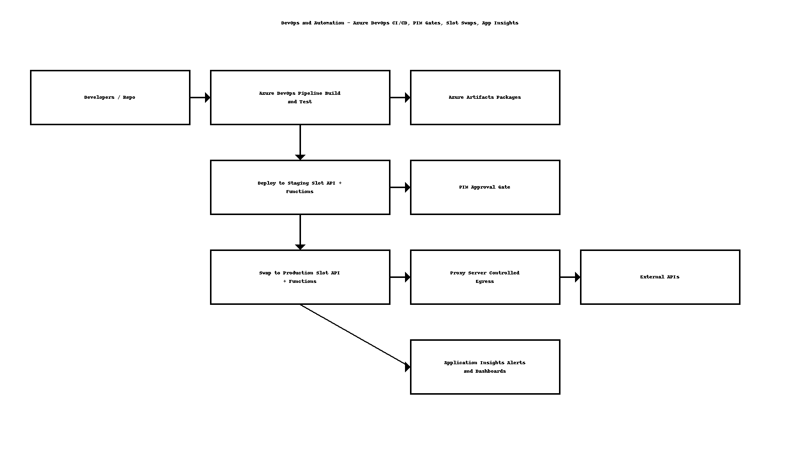
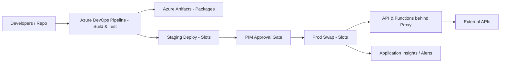

# DevOps & Automation — High-Level Design (HLD)

Author: Sagarika Chakraborty — Full Stack .NET Engineer | React.js | Web API | SQL Server

## 1. Objectives and Scope
The goal is to deliver fast, reliable, and secure releases for .NET APIs and Azure Functions using Azure DevOps. Key capabilities:
- End-to-end CI/CD with automated build, test, artifacting, and deployment.
- Secure egress via a proxy server for outbound API calls.
- PowerShell for environment bootstrap and post-deployment operations.
- Privileged Identity Management (PIM) for time-bound, auditable production approvals.
- Azure Artifacts for dependency and version management of internal packages.
- Slot-based deployments for zero-downtime releases and safe rollback.
- Application Insights for telemetry, alerting, and capacity planning.

## 2. Target Platform and Components
- Source control: Azure Repos or GitHub (mirrors supported)
- CI/CD: Azure DevOps Pipelines (YAML)
- Runtime: App Service (Web Apps for API) and Function Apps (Functions)
- Packages: Azure Artifacts feeds
- Identity & Security: Azure AD, PIM, Key Vault, Managed Identity
- Networking: Proxy server for outbound traffic to external APIs
- Observability: Application Insights, Azure Monitor
- Infra: ARM/Bicep/Terraform supported (optional)

## 3. Reference Architecture

## 4. Release Flow (Happy Path)
1. Commit triggers CI: restore, build, test, publish artifacts.
2. Staging deploy: infra check, configuration, smoke tests.
3. PIM approval gate: reviewer elevates via PIM to approve production.
4. Slot swap to production; warmup checks; post-deploy validations.
5. Telemetry and alerts monitored; autoscale rules applied.

## 5. Security and Compliance
- Secrets in Key Vault; access via Managed Identity.
- PIM-based elevation for production; approvals audited.
- Proxy enforced for outbound calls; deny-by-default firewall policy.
- Signed artifacts and checksums; least-privilege service connections.

## 6. Availability, DR, and Rollback
- Slot swaps for zero-downtime; instant rollback via swap-back.
- Backups for configuration and artifacts; infra state in IaC.
- Canary or ring-based rollout optional for sensitive changes.

## 7. Observability
- App Insights for traces, metrics, dependencies, and live metrics.
- Dashboards for deployment success rate, MTTR, error budgets.
- Alerts on p95 latency, failure rate, and queue depth.

## 8. Open Questions / Assumptions
- Staging parity with production ensured by environment templates.
- Proxy exceptions list reviewed and change-controlled.
- Artifact retention policies and SBOM generation defined.
