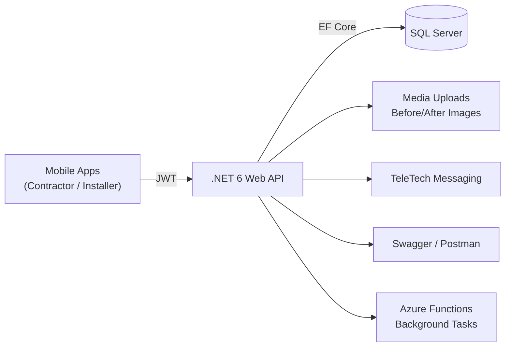

# EIS AMERICAS‑FMRS — High‑Level Design (HLD)

> **Client:** EIS Americas, USA  
> **Author:** Sagarika Chakraborty — Full Stack .NET Engineer | React.js | Web API | SQL Server

## 1) Overview & Scope
EIS AMERICAS‑FMRS streamlines contractor/installer operations for equipment installations:
- Customer order intake and **job creation**.
- Contractor **assignment** of installers/crews.
- Real‑time **status tracking**: ToBeAssigned → Assigned → InProgress → Completed → Reviewed.
- **Before/after** image capture for validation and compliance.
- **TeleTech** communication module for customer↔contractor↔installer messaging.
- **Feedback** collection and reporting.

## 2) Goals & NFRs
- **Security**: JWT auth, RBAC policies, HTTPS, message localization via `.resx` with safe defaults.
- **Reliability**: Idempotent updates, retry/backoff for background jobs, transactional writes.
- **Scalability**: Stateless API, background processing with Azure Functions, DB indexing.
- **Performance**: p95 < 300ms for reads; streaming uploads for images; pagination for lists.
- **Observability**: Correlation IDs, structured logs, telemetry hooks.
- **Maintainability**: **Four‑layer Clean Architecture** with Repository/Service patterns and automated tests.

## 3) Architecture

## 4) Core Components
- **Web API**: REST endpoints for jobs, orders, scheduling, assignments, media, TeleTech, and feedback.
- **Data Access**: EF Core (Code‑First), repositories, LINQ; migrations for schema.
- **Business Logic Layer**: Services for workflow/state, assignments, SLA rules.
- **Model Layer**: Request/Response DTOs; mapping profiles; validation attributes.
- **Utility Layer**: Helpers, validators, and **.resx** resources for messages.
- **Azure Functions**: Background tasks—notifications, cleanup, SLA checks, async media processing.
- **Swagger & Postman**: Documentation and integration verification.

## 5) Key Flows (Happy Paths)
1. **Job Creation**: Customer order → API creates Job (ToBeAssigned) → contractor notified.
2. **Assignment**: Contractor selects installer/crew → API sets status **Assigned**.
3. **Execution**: Installer starts work → uploads **before/after** images → status **InProgress/Completed**.
4. **Review**: Customer/contractor reviews & leaves **feedback** → status **Reviewed**.
5. **Comms**: TeleTech threads provide context‑rich chat and attachments throughout.

## 6) Security & Compliance
- JWT tokens; role claims (`Customer`, `Contractor`, `Installer`, `Admin`).
- Input validation; request size limits; content‑type checks for images.
- **Audit trail** for status transitions and feedback edits.
- PII minimization; parameterized queries; encrypted connections.

## 7) Availability & DR
- Multi‑AZ hosting; automated backups; PITR for SQL.
- Blue/green or slot‑based deployments for API/Functions; health probes; rollbacks.

## 8) CI/CD
- Azure DevOps **YAML** pipeline: restore → build → test → publish artifacts → deploy to **Azure Functions** / API.
- Environment strategy: Dev → QA → Prod with variable groups and approvals.

## 9) Assumptions
- Mobile apps handle auth/token refresh.
- Media stored in object storage/CDN (pluggable) with signed URLs.
- TeleTech uses persistent threads keyed by Job.
