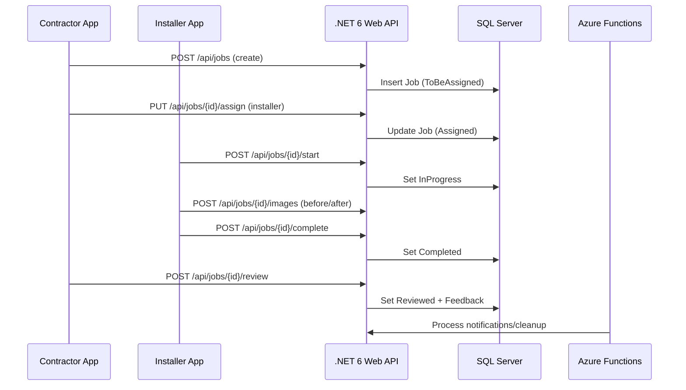

# EIS AMERICAS‑FMRS — Low‑Level Design (LLD)

> **Author:** Sagarika Chakraborty — Full Stack .NET Engineer | React.js | Web API | SQL Server

## 1) Solution Layout (Four‑Layer + Functions)
- **src/EisFmrs.Api** — ASP.NET Core 6 Web API (Controllers, Filters/Middleware, Swagger)
- **src/EisFmrs.Application** — Services (Jobs, Assignments, TeleTech, Media, Feedback), Validators
- **src/EisFmrs.Domain** — Entities, Aggregates, Value Objects, Enums (JobStatus), Domain Events
- **src/EisFmrs.Infrastructure** — EF Core DbContext, Repositories, Migrations, Storage Client, Message Bus (optional)
- **jobs/EisFmrs.Functions** — Azure Functions (timers/queues/webhooks) for async/offline work
- **tests/** — Unit/Integration/Contract tests

## 2) Endpoints (sample)
### Jobs & Orders
- `POST /api/jobs` — create job from order (status=ToBeAssigned)
- `GET /api/jobs/{id}` — details + timeline
- `GET /api/jobs?status=&contractorId=&installerId=&page=&size=` — list/filter
- `PUT /api/jobs/{id}/assign` — assign installer/crew → status=Assigned
- `POST /api/jobs/{id}/start` — mark InProgress
- `POST /api/jobs/{id}/complete` — mark Completed
- `POST /api/jobs/{id}/review` — capture Reviewed + rating/comments

### Media & Feedback
- `POST /api/jobs/{id}/images` — upload before/after images (streaming)
- `GET /api/jobs/{id}/images` — list signed URLs
- `POST /api/jobs/{id}/feedback` — rating/comments

### TeleTech (Communication)
- `POST /api/teletech/threads` — create thread `{ jobId }`
- `POST /api/teletech/threads/{id}/messages` — text/attachments
- `GET /api/teletech/threads/{id}` — thread with participants and history

### Admin/Meta
- `GET /api/health` — liveness/readiness
- `GET /swagger` — API docs

## 3) DTOs (examples)
```json
// JobCreateRequest
{
  "customerId": "guid",
  "productId": "guid",
  "preferredDate": "2025-10-15T09:00:00Z",
  "notes": "AC installation - rooftop unit"
}

// AssignInstallerRequest
{
  "installerId": "guid",
  "crew": ["guid","guid"]
}

// TeleTechMessageCreate
{
  "threadId": "guid",
  "message": "Arriving at site in 20 minutes",
  "attachments": ["https://.../photo1.jpg"]
}
```

## 4) Entities & Enums (excerpt)
- `Job(id, customerId, contractorId?, installerId?, status, preferredDate, scheduledAt?, completedAt?, reviewedAt?)`
- `JobStatus { ToBeAssigned, Assigned, InProgress, Completed, Reviewed }`
- `Image(id, jobId, type: Before|After, url, uploadedBy, at)`
- `Feedback(id, jobId, byUserId, rating, comments, at)`
- `TeleTechThread(id, jobId, participants[], createdAt)`
- `TeleTechMessage(id, threadId, senderId, text, attachmentsJson, at)`

## 5) Persistence (ER Overview)
**Tables**
- `Jobs`, `Images`, `Feedback`, `TeleTechThreads`, `TeleTechMessages`, `Users`, `Products`
Indexes: `Jobs(status, contractorId, installerId)`, `Images(jobId, type)`, `TeleTechMessages(threadId, at)`.

## 6) Validation & Rules
- Status transitions enforced; cannot Complete before InProgress, etc.
- Image content type & max size validation; virus scan hook optional.
- Feedback once per job per participant role (configurable).

## 7) Sequences


## 8) Error Handling
- `400` validation errors with field map
- `401/403` JWT/RBAC
- `404` not found
- `409` invalid state transition
- `413` payload too large (images)
- `5xx` transient errors (retry/backoff; circuit breaker on callers)

## 9) Observability
- Correlation ID middleware; structured logging
- Telemetry hooks for job lifecycle, media upload time, TeleTech activity
- Dashboards for p95 latency, error rate, queue depth (Functions)

## 10) CI/CD (Azure DevOps YAML → Azure Functions)
```yaml
trigger:
  branches: { include: [ main ] }

stages:
- stage: Build_Test
  jobs:
  - job: Build
    pool: { vmImage: 'windows-latest' }
    steps:
    - task: UseDotNet@2
      inputs: { packageType: 'sdk', version: '8.x' }
    - script: dotnet restore
    - script: dotnet build --configuration Release
    - script: dotnet test --configuration Release
    - task: PublishBuildArtifacts@1
      inputs: { PathtoPublish: '$(Build.ArtifactStagingDirectory)', ArtifactName: 'drop' }

- stage: Deploy_Functions
  dependsOn: Build_Test
  jobs:
  - deployment: Functions
    environment: 'dev'
    strategy:
      runOnce:
        deploy:
          steps:
          - task: AzureFunctionApp@2
            inputs:
              azureSubscription: '$(AZURE_CONN)'
              appName: '$(FUNC_APP_NAME)'
              package: '$(Pipeline.Workspace)/drop/**/*.zip'
```
