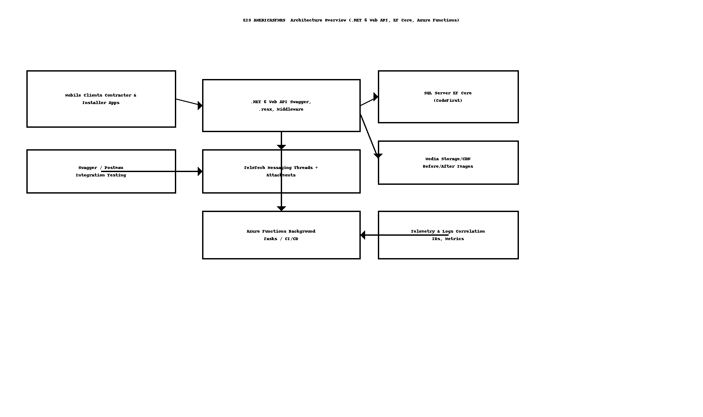
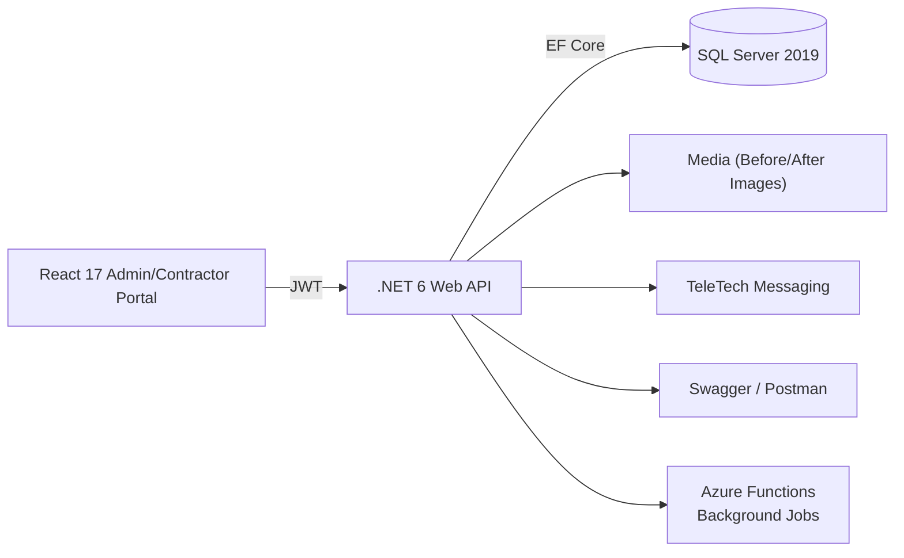

# EIS AMERICAS‑FMRS — High‑Level Design (HLD)

> **Client:** EIS Americas, USA  
> **Author:** Sagarika Chakraborty — Full Stack .NET Engineer | React.js | Web API | SQL Server

## 1) Overview & Scope
The **Admin & Contractor Web Application** is the command center for contractor operations and admin oversight. It allows:
- **Job & Order Management** from customer requests.
- **Assignments** of installers and crews.
- **Status tracking** across `ToBeAssigned → Assigned → InProgress → Completed → Reviewed`.
- **Before/After images** for validation and audit.
- **Feedback & TeleTech** threaded conversations between customers, contractors, and installers.
- **Dashboards & Reports** for utilization and performance.

## 2) Goals & NFRs
- **Security**: JWT + RBAC (Admin/Contractor/Installer), HTTPS, input validation, audit logging.
- **Scalability**: Stateless API, Azure Functions for async work, DB indexes and caching.
- **Reliability**: Idempotent APIs, retry/backoff, transactional boundaries.
- **Performance**: p95 < 300ms for core reads; image streaming; pagination for large lists.
- **Observability**: Structured logs, correlation IDs, telemetry dashboards.
- **Maintainability**: Four‑layer clean architecture, repository/service patterns, automated tests.

## 3) Architecture

## 4) Components
- **React Portal**: SPA for Admin/Contractor/Installer roles; dashboards; CRUD screens.
- **Web API**: REST endpoints for jobs, orders, assignments, feedback, media, TeleTech.
- **SQL Server**: Authoritative store using EF Core (Code‑First) with migrations.
- **Azure Functions**: Notifications, job updates, payment confirmations, cleanups.
- **Utilities**: Message localization (optional), helpers/validators.
- **DevOps**: Azure DevOps pipelines deploying both API and React app.

## 5) Key Flows (Happy Paths)
1. **Request Intake** → job created (`ToBeAssigned`).
2. **Assignment** → contractor assigns installer/crew (status `Assigned`).
3. **Execution** → installer updates progress, uploads images (status `InProgress/Completed`).
4. **Review** → feedback captured; status `Reviewed`.
5. **Comms** → TeleTech threads maintain context throughout the job lifecycle.

## 6) Security & Compliance
- JWT tokens with roles; least‑privilege policies per route.
- Validations for payload size, file types, and state transitions.
- Audit trail for job updates, assignments, and reviews.
- PII minimization; encrypted connections; parameterized SQL.

## 7) Availability & DR
- Multi‑AZ hosting; automated backups & PITR.
- Blue/green or slot‑based deployments; health probes and rollbacks.

## 8) CI/CD
- Azure DevOps YAML: restore → build → test → publish → deploy (API + React).
- Environment strategy: Dev → QA → Prod with approvals and variable groups.

## 9) Assumptions
- Media stored in object storage/CDN (signed URLs).
- TeleTech threads keyed by Job.
- Push notifications pluggable (e.g., Azure Notification Hubs).
