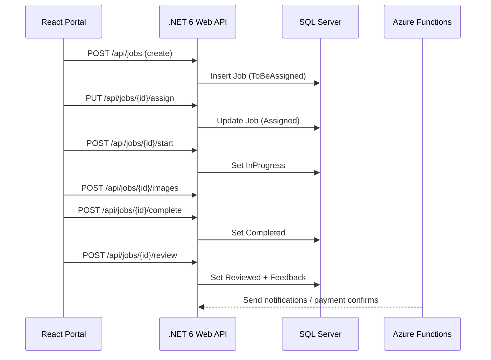

# EIS AMERICAS‑FMRS — Low‑Level Design (LLD)

> **Author:** Sagarika Chakraborty — Full Stack .NET Engineer | React.js | Web API | SQL Server

## 1) Solution Layout (Four‑Layer + Functions + React)
- **src/EisFmrs.Api** — ASP.NET Core 6 Web API (Controllers, Middleware, Swagger)
- **src/EisFmrs.Application** — Services (Jobs, Assignments, Media, TeleTech, Feedback), Validators
- **src/EisFmrs.Domain** — Entities, Aggregates, Enums (`JobStatus`), Domain Events
- **src/EisFmrs.Infrastructure** — EF Core DbContext, Repositories, Migrations, Storage Client
- **web/admin-portal** — React 17 SPA (routes, components, hooks, services)
- **jobs/EisFmrs.Functions** — Azure Functions (timers/queues/webhooks)
- **tests/** — Unit/Integration/Contract/UI tests

## 2) React Modules
- **Auth** (JWT storage/refresh, role‑aware routing)
- **Dashboard** (status KPIs, crew utilization, feedback trends)
- **Jobs** (list/detail, assign, upload images, timeline)
- **Contractors/Installers** (CRUD)
- **Feedback & Reviews** (moderation)
- **TeleTech** (threaded conversations per Job)

## 3) API Endpoints (sample)
### Jobs & Orders
- `POST /api/jobs` — create from customer request (status=ToBeAssigned)
- `GET /api/jobs/{id}` — detail with timeline/images
- `GET /api/jobs?status=&contractorId=&installerId=&page=&size=`
- `PUT /api/jobs/{id}/assign` — set installer/crew → status=Assigned
- `POST /api/jobs/{id}/start` — InProgress
- `POST /api/jobs/{id}/complete` — Completed
- `POST /api/jobs/{id}/review` — Reviewed + feedback

### Media & Feedback
- `POST /api/jobs/{id}/images` — streaming upload (before/after)
- `GET /api/jobs/{id}/images` — signed URLs
- `POST /api/jobs/{id}/feedback` — rating/comments

### TeleTech
- `POST /api/teletech/threads` — create `{ jobId }`
- `POST /api/teletech/threads/{id}/messages`
- `GET /api/teletech/threads/{id}`

### Admin/Meta
- `GET /api/health`
- `GET /swagger`

## 4) DTOs (examples)
```json
// AssignInstallerRequest
{ "installerId": "guid", "crew": ["guid"] }

// FeedbackRequest
{ "rating": 5, "comments": "Great job, on time!" }
```

## 5) Entities & Enums (excerpt)
- `Job(id, customerId, contractorId?, installerId?, status, preferredDate, scheduledAt?, completedAt?, reviewedAt?)`
- `JobStatus { ToBeAssigned, Assigned, InProgress, Completed, Reviewed }`
- `Image(id, jobId, type: Before|After, url, uploadedBy, at)`
- `Feedback(id, jobId, byUserId, rating, comments, at)`
- `TeleTechThread(id, jobId, participants[], createdAt)`
- `TeleTechMessage(id, threadId, senderId, text, attachmentsJson, at)`

## 6) Persistence (ER Overview)
**Tables**: `Jobs`, `Images`, `Feedback`, `TeleTechThreads`, `TeleTechMessages`, `Users`, `Contractors`, `Installers`, `Products`  
**Indexes**: `Jobs(status, contractorId, installerId)`, `Images(jobId, type)`, `TeleTechMessages(threadId, at)`.

## 7) Sequences


## 8) Error Handling
- `400` validation errors with field map
- `401/403` JWT/RBAC
- `404` not found
- `409` invalid state transition
- `413` payload too large (images)
- `5xx` transient errors (retry/backoff; circuit breaker on clients)

## 9) Observability
- Correlation ID middleware; structured logs
- Telemetry for job lifecycle, image upload time, TeleTech activity
- Dashboards: p95 latency, error rate, queue depth, assignment SLA

## 10) CI/CD
- Azure DevOps YAML: build/test → publish → deploy API + React
- Environments: Dev / QA / Prod with approvals; slot/canary options

## 11) Runbooks
- Failed image uploads; stuck TeleTech threads; job status inconsistencies
- Hotfix process and slot swap rollback
- Secrets rotation and token revocation
```
