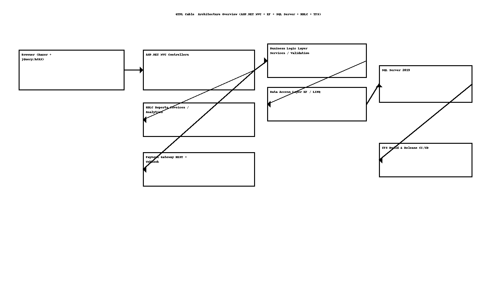
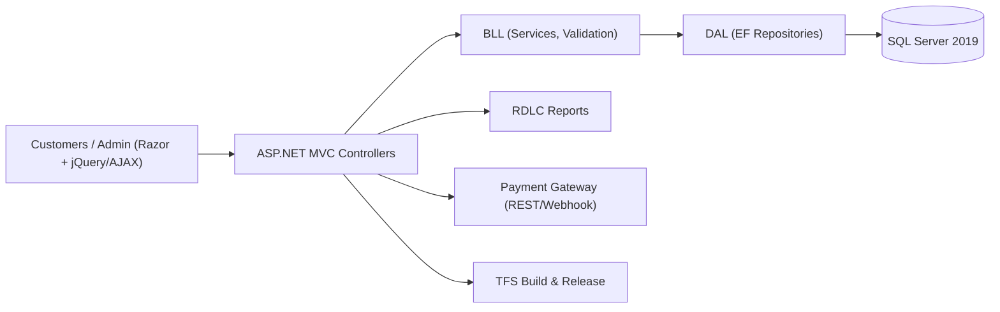

# GTPL Cable Connection — High‑Level Design (HLD)

> **Author:** Sagarika Chakraborty — Full Stack .NET Engineer | React.js | Web API | SQL Server

## 1) Overview & Scope
A web portal for **digital cable/DTH** to manage **subscribers**, **plans**, and **recharges**:
- Customer self‑service: registration/login, browse plans/add‑ons, recharge, track usage/billing.
- Admin operations: manage plans/pricing, subscriber lifecycle, invoices, promotions, analytics.
- Reporting via **RDLC** (billing, collections, plan analytics).

## 2) Goals & NFRs
- **Security**: AuthN/Z, HTTPS, CSRF, input validation; no card data stored (offsite gateway).
- **Performance**: Optimized EF/LINQ; pagination & caching on catalogue and reports.
- **Reliability**: Transactional recharge posting; idempotent payment webhooks.
- **Scalability**: Stateless controllers; DB indexes; optional caching layer.
- **Observability**: Structured logs, correlation IDs, admin audit.
- **Maintainability**: 3‑layer architecture (BLL/DAL/Models) with repository pattern.

## 3) Architecture

## 4) Modules
- **Subscriber**: registration/KYC, equipment/account details, address management.
- **Plan & Add‑on**: catalogue, pricing, taxes, promotions, eligibility.
- **Recharge**: payment initiation, receipt/invoice, renewal reminders.
- **Billing**: plan history, invoices, usage; refunds & adjustments (admin).
- **Reporting**: RDLC templates for invoices, collections, plan uptake.
- **Admin Console**: CRUD for plans, subscribers, promotions; role‑based access.

## 5) Key Flows
1. **New Subscriber** → register → choose base plan + add‑ons → pay → activate & generate invoice.
2. **Recharge** → select validity/plan → gateway payment → webhook capture → extend validity → receipt issued.
3. **Plan Change** → pro‑rated adjustment (if enabled) → confirmation & record update.
4. **Reporting** → run RDLC → export to PDF/Excel.

## 6) Security & Compliance
- ASP.NET Identity/Forms auth; role claims (Admin, Operator, Subscriber).
- Anti‑forgery tokens; server‑side validation; rate limits on payment actions.
- PCI‑DSS alignment via hosted payment page/webhooks; signed callbacks.

## 7) Availability & DR
- Scheduled DB backups; PITR testing.
- Staged deployments via **TFS** with config transforms and smoke tests.

## 8) CI/CD
- TFS pipelines: restore → build → test → package → deploy.
- Environment variables per Dev/QA/Prod; secret management in release variables.
