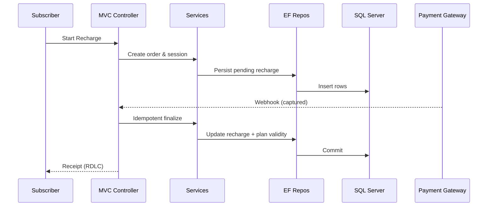

# GTPL Cable Connection — Low‑Level Design (LLD)

> **Author:** Sagarika Chakraborty — Full Stack .NET Engineer | React.js | Web API | SQL Server

## 1) Solution Layout (3‑Layer)
- **GTPL.Web** — ASP.NET MVC (Controllers, Razor, Filters, Bundles)
- **GTPL.BLL** — Services (Subscribers, Plans, Recharge, Billing, Reports), Validators
- **GTPL.DAL** — EF DbContext, Repositories, Migrations/SQL scripts
- **GTPL.Models** — Entities, DTOs/ViewModels
- **Reports/** — RDLC templates (Invoice, Collections, Plan Analytics)
- **Tests/** — Unit tests for BLL/DAL

## 2) Controllers & Actions (samples)
### SubscriberController
- `Register()` GET/POST — onboarding, KYC
- `Profile(id)` — view/update profile
- `History(id)` — plan/billing history

### PlanController
- `Index()` — browse base plans & add‑ons
- `Change(planId)` — change/upgrade (pro‑rate optional)

### RechargeController
- `Start(planId)` — create payment session
- `Webhook()` — gateway callback (idempotent)
- `Receipt(orderId)` — invoice (RDLC)

### AdminController
- `Plans()` — CRUD, pricing, promotions
- `Subscribers()` — manage & search
- `Reports()` — run/export RDLC

## 3) DTOs (examples)
```json
// RechargeStartRequest
{ "subscriberId": 98765, "planId": 1234, "amount": 499.00 }

// Webhook (simplified)
{ "orderId": "GTPL-2025-0001", "status": "captured", "amount": 499.00 }
```

## 4) Validation & Rules
- Unique subscriber mobile/email; KYC completeness checks.
- Plan eligibility rules; add‑on compatibility.
- Idempotency key on payment; avoid duplicate capture.
- Grace period & proration configurable in admin.

## 5) Persistence (ER Overview)
**Tables**
- `Subscribers(id, name, email, phone, addressId, stbId, status, createdAt)`
- `Addresses(id, line1, line2, city, state, zip, country)`
- `Plans(id, name, type, price, durationDays, taxRate, isActive)`
- `SubscriberPlans(id, subscriberId, planId, startDate, endDate, status)`
- `Recharges(id, subscriberId, planId, orderId, amount, status, at)`
- `Payments(id, orderId, provider, txnId, status, amount, at)`
- `Invoices(id, rechargeId, number, pdfUrl, at)`

Indexes: `Subscribers(phone)`, `SubscriberPlans(subscriberId, status)`, `Recharges(orderId) unique`.

## 6) Sequences


## 7) Error Handling
- `400` validation (field map for AJAX)
- `401/403` auth/authorization
- `404` not found
- `409` invalid state/duplicate payment
- `5xx` generic failure (log correlation id returned)

## 8) Performance
- EF includes for hot paths; indexes on lookups.
- Output caching for plan catalogue; pagination for histories.
- Async streaming for invoice downloads.

## 9) CI/CD (TFS)
- Build → test → package → deploy
- Config transforms; DB migration job
- Rollback via last successful artifact; DB restore SOP

## 10) Reports
- RDLC: **Invoice**, **Collections**, **Plan Uptake/Churn** with export to **PDF/Excel**.
