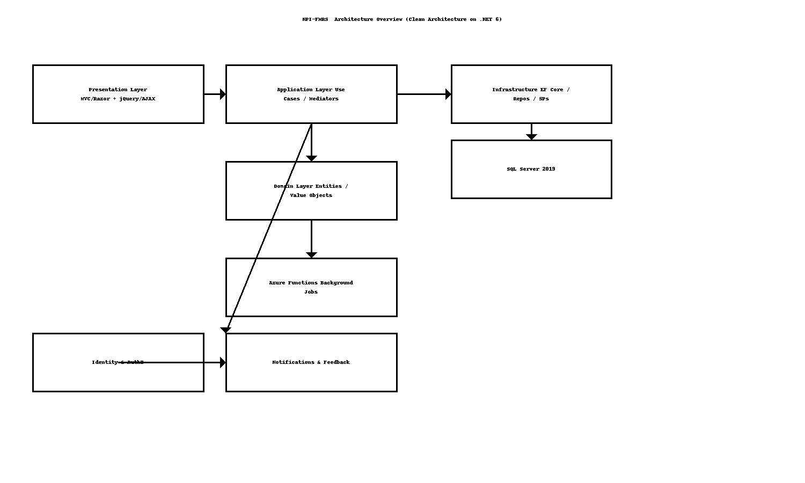
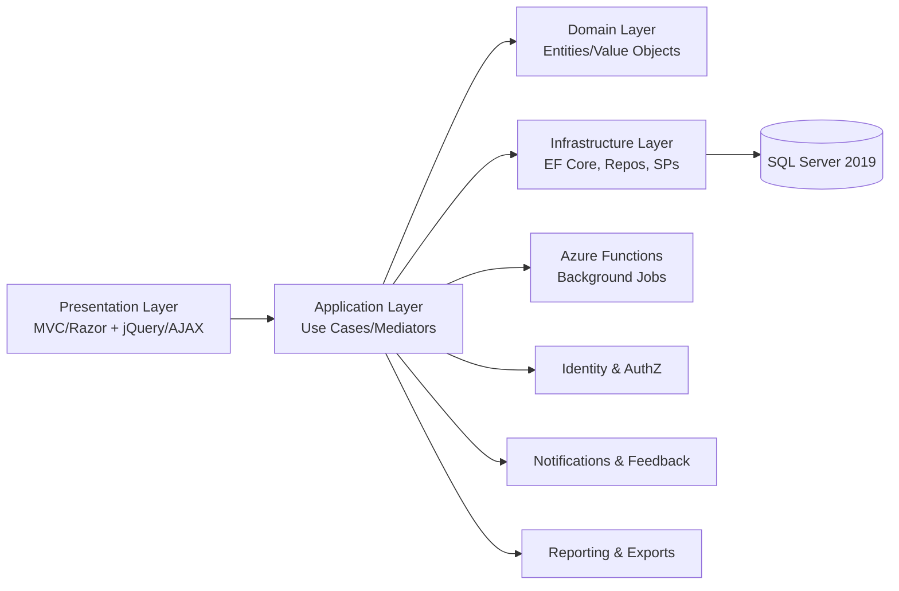

# NPI-FMRS — High-Level Design (HLD)

> **Author:** Sagarika Chakraborty — Full Stack .NET Engineer | React.js | Web API | SQL Server  
> **Client:** National Property Inspection, Nebraska (USA)

## 1. Overview & Scope
NPI-FMRS is a Clean-Architecture enterprise platform for **property inspections** that supports:
- **Role-based UX** for Owners, Inspectors, and Admins.
- **Scheduling, Bidding, Field Reporting, Feedback, Notifications**, and **Analytics**.
- **Near real-time background tasks** via Azure Functions.
- **CI/CD** using Azure DevOps (and Jenkins), with shared dependencies in **Azure Artifacts**.

## 2. Goals & NFRs
- **Security:** ASP.NET Core Identity, Authorization Handlers, HTTPS/TLS, audit trails, least-privilege access.
- **Scalability:** Stateless API, Azure Functions for background jobs, DB indexes and caching.
- **Reliability:** Retries + circuit breakers (Polly optional), idempotent jobs, message/outbox patterns.
- **Performance:** p95 < 300ms for common read paths; optimized EF Core queries; SPs for heavy ops.
- **Observability:** Structured logs, correlation IDs, (optional) App Insights dashboards.
- **Maintainability:** Four-layer separation with DI; clear module boundaries; tests at multiple levels.

## 3. Architecture

## 4. Modules & Responsibilities
- **Owner Module:** Properties, inspection requests, bid participation, report access.
- **Inspector Module:** Assignment queue, bidding, report submission, availability.
- **Bidding Module:** Auction-style bids, reserve/min increments, SLA windows.
- **Feedback Module:** Owner/customer feedback, ratings, comments.
- **Notification Module:** Real-time updates (email/SMS/provider hooks).
- **Reporting Module:** Inspection reports, exports, compliance templates.
- **Cross-Cutting:** Identity, Authorization Handlers, Middleware (validation, exceptions, correlation), DI.

## 5. Key Flows (Happy Paths)
1. **Inspection Request:** Owner posts request → Application layer validates → persists → notifies eligible inspectors.
2. **Bidding:** Inspectors bid → rules evaluated → winner selected → schedule generated.
3. **Field Report:** Inspector submits report (media, notes) → stored → owner notified → feedback opened.
4. **Notifications:** Status changes publish events → Functions deliver notifications and escalations.
5. **Analytics/Exports:** Aggregates built from SQL views/SPs → exported for business stakeholders.

## 6. Security & Compliance
- **AuthN/Z:** ASP.NET Core Identity with role/claim policies; Authorization Handlers for fine-grained checks.
- **Data:** PII minimization, parameterized queries, encrypted connection strings.
- **Transport:** HTTPS only; HSTS; CSRF protection on forms; input validation and size limits.
- **Audit:** Entity-level auditing for key actions (create/update/bid/assign/report).

## 7. Availability & DR
- Multi-AZ hosting; automated backups/PITR; health probes.
- Blue/green or rolling deployments with Jenkins/Azure DevOps; rollback artifacts.

## 8. CI/CD
- **Build:** compile, test, static analysis → publish to **Azure Artifacts**.
- **Release:** infra hooks + approvals → deploy API + Functions; smoke tests; telemetry gates.

## 9. Assumptions & Open Items
- SMS/email vendor configurable.
- Export formats (PDF/Excel) governed by client policy.
- Multi-tenant support can be enabled via schema or discriminator key if needed.
