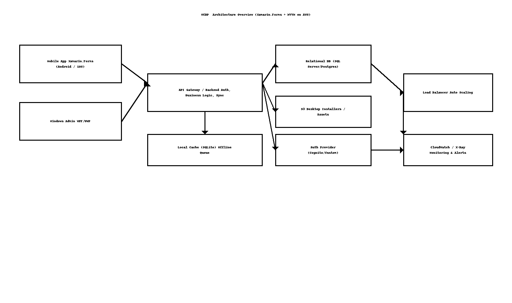
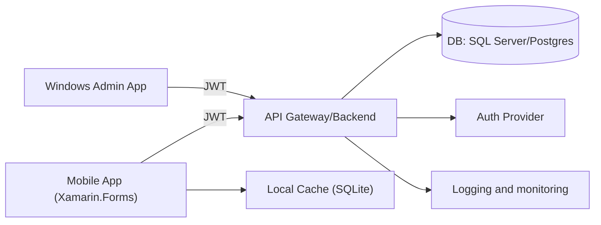

# WCDP – High-Level Design (HLD)

> **Client:** Dry Wall, West Coast, California, USA  
> **Author:** Sagarika Chakraborty — Full Stack .NET Engineer | React.js | Web API | SQL Server

## 1. Overview & Scope
**WCDP** provides a **mobile app** for field employees (Android/iOS) and a **Windows desktop app** for administrators to manage time tracking, attendance, and task assignments. Built with **Xamarin.Forms** and **MVVM**, WCDP integrates with secure backend APIs and supports **offline-first** usage with synchronization. CI/CD runs on **Azure DevOps** and **Jenkins**.

## 2. Goals & NFRs
- **Usability**: Consistent cross-platform UX with reusable XAML styles/themes.
- **Reliability**: Offline cache with conflict resolution; idempotent sync.
- **Performance**: Fast page loads; background sync; pagination for history.
- **Security**: JWT/OAuth, TLS, secure storage for tokens; least-privilege access.
- **Scalability**: Auto-scaling and load balancing for peak workforce hours.
- **Observability**: Centralized logs/metrics; crash analytics for mobile; APM for APIs.

## 3. Architecture

## 4. Components
- **Mobile App (Xamarin.Forms)**: Punch in/out, attendance, tasks; offline cache + background sync.
- **Windows Admin App**: Assign tasks, monitor attendance/timecards, generate reports.
- **Backend API**: AuthN/Z, business logic, sync endpoints, reporting.
- **Data Store**: Relational DB for authoritative data; **SQLite** on-device cache.
- **CI/CD**: Azure DevOps and Jenkins pipelines; automatic builds and releases to the app stores.
- **Security**: OAuth/JWT tokens; HTTPS; role-based access; secrets kept out of source.

## 5. User Journeys (Happy Paths)
1. **Employee Punch** → mobile app records punch (offline if necessary) → syncs to API → timecard updated.
2. **Attendance Report** → admin desktop queries API → aggregated results shown/exported.
3. **Task Assignment** → admin creates tasks → employees receive & update status → analytics reflect progress.

## 6. Availability & DR
- Multi-AZ backend; auto-scaling; daily automated backups.
- Blue/green or rolling deployments; health checks and alarms.

## 7. CI/CD & Distribution
- A commit triggers the pipeline, which runs tests and publishes artifacts.
- Mobile packages delivered to **Play Store**/**App Store**; desktop installer from the release pipeline.
- Pipeline permissions restrict who can build and deploy.

## 8. Assumptions
- Backend provides REST endpoints; push notifications optional (SNS/Firebase/APNS).
- MDM/Intune may be used for enterprise distribution (optional).
